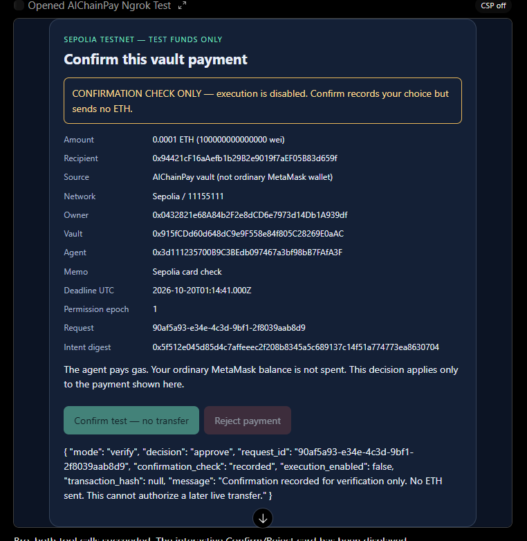
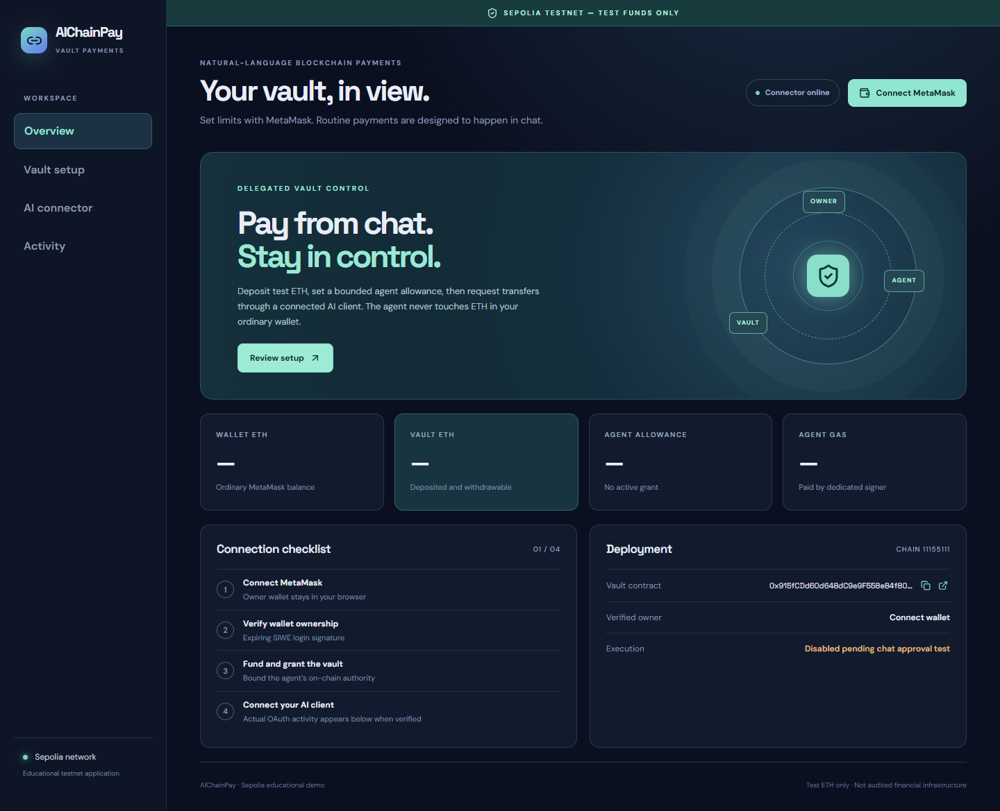
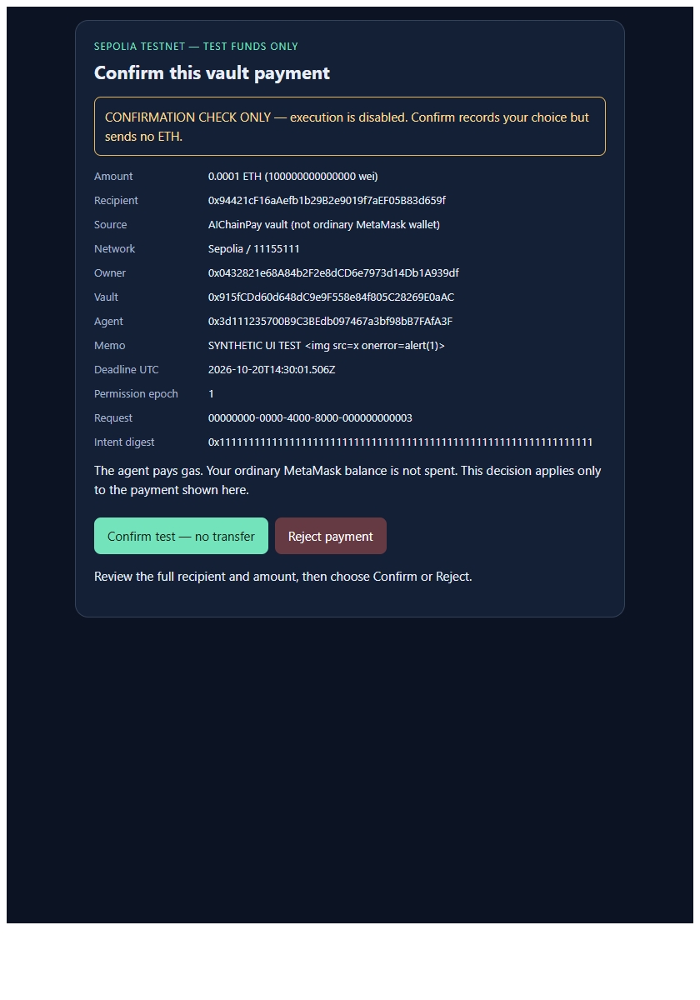

# AIChainPay
Natural-language payments from a bounded Solidity vault. **Sepolia test ETH only.**

## What works and what is not claimed
The Sepolia vault, owner MetaMask setup, authenticated ChatGPT reads, exact in-chat confirmation, agent-signed transfer, recipient receipt and authenticated `confirmed` status have been observed. The [0.0001 ETH payment](https://sepolia.etherscan.io/tx/0x2bfe8bfc442c084cc012fed2b345044819bad1a11dfef682fea7a7e0cbff01cf) succeeded in block **11952073**; do not repeat that request. A real [revoke](https://sepolia.etherscan.io/tx/0x1e8d94f28b434eb393d8e16e830bdd52cb28b7ccc6ceeddd9fcbf7d72) and later [regrant](https://sepolia.etherscan.io/tx/0x5759f2a59d21ad4e1842cb3c07eff8a1e205498d7ebd08bc8c908612e93e4526) were also observed. Local over-limit and rejection tests pass; a live over-cap preparation was refused without a transaction. This is not an audited or permanently hosted service, and GitHub publication/CI have not been verified.

A new **in-chat MCP Apps confirmation card** is implemented and locally tested. On 2026-10-20, its real ChatGPT rendering, verification-only Confirm and Reject, and separate live-mode Confirm were observed and matched to backend audit. It shows the exact payment and requires its own Confirm/Reject action, rather than treating remembered tool approval as payment approval. Host isolation is a trust assumption. No website approval fallback is used.

| Public deployment | Value |
| --- | --- |
| Network | Sepolia, chain ID 11155111 |
| Vault | [0x915fCDd60d648dC9e9F558e84f805C28269E0aAC](https://sepolia.etherscan.io/address/0x915fCDd60d648dC9e9F558e84f805C28269E0aAC) |
| Creation transaction | [0xcd059159f582a2783da6f7652d4fec4c390e1696db1b596b2b291ee78005d46d](https://sepolia.etherscan.io/tx/0xcd059159f582a2783da6f7652d4fec4c390e1696db1b596b2b291ee78005d46d) |
| Deployment block | 11947272 |
| Dashboard (current laptop demo) | https://upscale-nanometer-duvet.ngrok-free.dev |
| MCP (OAuth) | https://upscale-nanometer-duvet.ngrok-free.dev/mcp |
| Dedicated agent | 0x3d111235700B9C3BEdb097467a3bf98bB7FAfA3F |

The laptop, connector and ngrok must remain running. This is not permanent hosting. RPC verification confirms the deployed runtime bytecode, ABI and creation receipt; explorer source verification is not claimed.

**Availability checked 2026-10-20:** the user restored ngrok. Public health and both OAuth discovery endpoints returned 200 with matching issuer/resource; unauthenticated MCP correctly returned 401. OAuth access was renewed and real card decisions reached the server. After the live transfer, an authenticated public MCP status call returned the confirmed transaction.

Availability changes when the laptop or tunnel stops. Before a demonstration, open the public `/health` URL and check that `server`, `rpc` and `vault` are true. The dashboard's four-step checklist uses current wallet/grant state and historical authenticated MCP activity; the fourth check is not proof that an OAuth token is still valid.

## Flow and trust
MetaMask connects and signs a login message. The owner deposits ETH and grants the dedicated agent a total allowance, per-payment cap, expiry and optional recipient restriction. An empty recipient list permits any valid recipient under the other limits. Grants replace previous grants and can cover future deposits.

**Any supported MetaMask EOA can be an owner.** The contract does not hard-code the original wallet: `deposit()` credits `msg.sender`, and permissions are stored per owner and agent. Each new owner sees only their own balance and requests after wallet sign-in, must deposit their own Sepolia test ETH, and must grant the configured agent separately. A smart-contract wallet is not supported by this v1 SIWE login. The deployed contract and connector may be shared, but the connector currently uses one configured agent address and a local database; another user does not need a new contract deployment.

ChatGPT authenticates with OAuth/PKCE linked to that owner. It prepares an immutable payment, then opens the in-chat confirmation card. In live mode, a valid card decision allows the agent to call the vault. The contract checks the live grant, epoch, caps, recipient, balance, deadline and replay ID; the recipient receives actual ETH. The agent pays gas from its own wallet. Your ordinary MetaMask balance and key are never used for routine agent payments.

The dashboard includes a wallet-authenticated **Developer diagnostics** tab for read-only chain, request-state and indexing inspection through the same API used by the Activity screen. It cannot approve or execute a payment; routine approval remains in ChatGPT.

The backend and chat host remain trusted components. The card's random one-use capability is delivered in widget-only tool-result metadata; its callback is declared app-only. Server checks bind it to owner, OAuth client, exact intent digest, expiry and verify/live mode. These are not a wallet signature or cryptographic proof of a human: a malicious host or compromised backend remains outside this protection. No approval token is put in model-visible content, widget state or URLs. See [security](./docs/security.md) and [client integration](./docs/client-integration.md).

## Run on the existing demonstration laptop (Windows PowerShell)
Prerequisites: Node.js >=22.13, npm, the already configured **ignored local** Sepolia RPC/connector files, and an assigned HTTPS host. The contract is already deployed; do not deploy it again. Commands are in [package.json](./package.json). If port 3000 is already listening, use that connector rather than starting a duplicate.

```powershell
cd D:\AIChainPay
npm.cmd ci
npm.cmd run build
npm.cmd run verify:sepolia
npm.cmd run start:sepolia -- --live
```

The last command is for this *already validated* local connector: it checks recorded real-card verification, its matching agent key and the local flags before enabling payment. On a fresh setup use `npm.cmd run start:sepolia` first; that launches **with execution disabled**. Never set approval flags merely to skip the real client test.

In a second PowerShell window, only if the assigned tunnel is offline and the connector is deliberately in live mode:

```powershell
cd D:\AIChainPay
.\scripts\start-stable-ngrok.ps1 -PublicBaseUrl https://upscale-nanometer-duvet.ngrok-free.dev -AllowLiveConnector
```

The script prompts for the ngrok token locally without printing it. Leave both windows open. Check [public health](https://upscale-nanometer-duvet.ngrok-free.dev/health) before using the [public dashboard](https://upscale-nanometer-duvet.ngrok-free.dev). The ChatGPT OAuth issuer and MCP URL must have that same HTTPS origin. The local `http://127.0.0.1:3000` page is useful for diagnostics but is not the public OAuth origin. **Ngrok is only an HTTPS route to this laptop**; a stable hosted HTTPS connector could replace it. Without either, ChatGPT cannot call a localhost-only MCP server.

### A different person using their own wallet
The operator keeps the connector and HTTPS route running. The new user opens the public dashboard, connects a **MetaMask EOA** on Sepolia, and clicks **Verify wallet** to sign the SIWE *login message* (no transaction or spending authority). Their initial vault balance and grant are zero. To send a chat payment, they deposit a small amount of **Sepolia test ETH** into their own vault credit; this owner-signed transaction moves that test ETH from the ordinary wallet into the vault contract, where it remains withdrawable unless spent. Next they sign their own bounded grant to the displayed agent address: total allowance, per-payment cap and expiry are required; the recipient list is optional (blank allows any valid address). **That grant authorizes the agent to spend deposited credit up to those limits, including future deposits until expiry or revoke; it does not expose the wallet key.** Both on-chain actions cost wallet gas. They then install the custom MCP plugin in ChatGPT with server URL `https://upscale-nanometer-duvet.ngrok-free.dev/mcp`, choose OAuth, complete wallet-linked authorization, and refresh tools. Their ChatGPT account and grant are separate from the original owner's. A new user should confirm the agent has sufficient Sepolia ETH for gas; funding the agent is an operator action, not a deposit into the user's vault.

In ChatGPT, first ask: “Use AIChainPay only to call `get_supported_network`, `get_wallet_address`, `get_contract_balance`, and `get_agent_permission`. Do not prepare a payment.” For a real transfer, provide a recipient you control and a small amount within *your own* limits, then ask for `prepare_payment` followed by `show_payment_confirmation` with the returned request ID/digest. Inspect the exact live card and click **Confirm** only if you intend that vault transfer. `prepare_payment` alone sends no ETH. Do not ask the model to call legacy `execute_payment`; the live card adapter refuses model-initiated execution. A separate `get_request_status` call reports the receipt; a spinning card is not a reason to click twice.

### Fresh operator installation on another computer
1. Install Node.js >=22.13, clone/copy this repository, then run `npm.cmd ci` and `npm.cmd run build` from its root. The [manifest](./packages/shared/src/deployment.11155111.json) already identifies the Sepolia vault.
2. Copy [.env.example](./.env.example) to an ignored local `.env` and enter a Sepolia RPC URL **locally**. The deployer key is not needed to reuse this deployment. Run `npm.cmd run verify:sepolia`.
3. Obtain a stable public HTTPS origin (assigned ngrok hostname or your own host). Run `npm.cmd run setup:sepolia-connector -- https://YOUR-HTTPS-ORIGIN` **once**. The script checks chain/bytecode, writes ignored [connector configuration](./connector/.env.example) and generates a *new* local agent key. Do not overwrite an existing connector configuration or copy private keys from chat. The new agent needs test ETH for gas, and each owner must grant **that new agent**; the old grant does not transfer to a new agent.
4. Start disabled with `npm.cmd run start:sepolia`; expose the configured HTTPS origin and test OAuth/read tools plus verification-only Confirm and Reject. Live startup is gated by those real-host records and local configuration, as described in [client integration](./docs/client-integration.md). A fresh database cannot inherit the old laptop's ChatGPT approval evidence. The assigned ngrok hostname is account-specific; it is not automatically available on another computer.

Never commit `.env`, agent keys, OAuth signing keys, SQLite data, tokens or raw signed transactions. Do not use mainnet funds. Claude has not been verified.

## Tests and builds
```powershell
npm.cmd test
npm.cmd run build
npm.cmd run test:payment-card
npm.cmd run verify:sepolia
npm.cmd run check:git-safety
```
Latest: **9 contract tests, 12 backend tests passed**, full build passed (non-fatal frontend chunk-size warning). Browser card test passed under a synthetic MCP Apps host: no automatic approval, trusted interaction handling, exact argument binding, safe memo rendering, confirm/reject and mobile layout. This is NOT real ChatGPT evidence.

On 2026-10-20, a fresh source-only temporary copy with no private configuration also passed `npm.cmd ci --no-audit --no-fund`, the full build and all 21 tests. Dependency installation reported transitive deprecations; the forced-ETH contract test fixture reported a selfdestruct warning. These were not build failures.

With the existing separate local chain on 31337:
```powershell
npm.cmd run test:local-card-execution
npm.cmd run test:local-execution
```
Both passed. The card pipeline test verified a real local-chain transfer of 0.0001 ETH, exact recipient increase, matching receipt/event, idempotent retry, rejection, over-limit failure and revocation. The older controlled-stub test verified concurrent nonces and crash recovery. Neither proves a Sepolia/chat transfer. These scripts explicitly refuse non-local chain execution.

For isolated local-chain execution checks, use a **separate checkout** with no Sepolia credentials. Run `npm.cmd ci` and `npm.cmd run build`, then `npm.cmd run chain` in one terminal. In another terminal in that checkout, run `npm.cmd run deploy:local`, followed by the two local execution-test commands above. These tests connect directly to localhost:8545 and need no public tunnel or ChatGPT connection. The local deployment manifest must be regenerated after restarting the chain. Never use local deterministic keys on Sepolia or overwrite this workspace's Sepolia configuration.

## Actual evidence
- Owner [0.001 ETH deposit](https://sepolia.etherscan.io/tx/0x6106e7761ffba3cb274847d843b3e39fff9f58f03b9779fdda1eb458f9801ada): receipt, vault event, value and credited balance verified, block 11948665.
- Owner [grant](https://sepolia.etherscan.io/tx/0x1c5c4491b3571a0cb5464d80305ae28438a54daccfd77d77f4d596fe1838570f): vault event and live permission verified, block 11948713. Owner accepted 0.005 ETH total / 0.001 ETH per payment / unrestricted recipients, expiry 2026-10-20 14:17:49 UTC. The outer transaction uses a different routing contract; direct vault calldata verification was not claimed.
- After the live payment, owner vault credit was 0.0209 ETH and grant allowance 0.0049 ETH; additional deposits beyond the recorded one were not individually audited. Agent gas was funded by [direct owner-to-agent transaction](https://sepolia.etherscan.io/tx/0x4e14c2530a67a557f5160b2d12bcc0397433b0d94af6a2ca212378595836700b) for 0.001 ETH; balance and block delta were checked.
- Real ChatGPT Sepolia reads, preparations, verification-only approval/rejection, and a live-mode approval are recorded. The [first live payment](https://sepolia.etherscan.io/tx/0x2bfe8bfc442c084cc012fed2b345044819bad1a11dfef682fea7a7e0cbff01cf) succeeded in block 11952073: exact 0.0001 ETH recipient increase, matching event, owner credit decrease and allowance decrease. Authenticated MCP status returned `confirmed`; the user later saw 38 confirmations in ChatGPT. A separate authenticated 0.002 ETH preparation exceeded the earlier 0.001 ETH cap and was refused without a transaction.
- The owner later [revoked](https://sepolia.etherscan.io/tx/0x1e8d94f28b434eb393d8e16e830bdd52cb28b7ccc6ceeddd9fcbf7d72) and [regranted](https://sepolia.etherscan.io/tx/0x5759f2a59d21ad4e1842cb3c07eff8a1e205498d7ebd08bc8c908612e93e4526). A read-only simulation during the revoked interval returned `PermissionInactive`; no reverted agent transaction was broadcast. The newer grant's limits/expiry must be read afresh before each demo.
- Another [0.000232 ETH agent transaction](https://sepolia.etherscan.io/tx/0xce0880e7d03f79a69e190db0b25bcd64fe367b780f3f572bb110006cba20ac62) has a successful receipt and matching vault event. Its local request row had not yet reconciled past `submitted` at the last check, and no independent screenshot of that approval click is available; do not present it as a second fully verified ChatGPT demonstration.



This screenshot matches request `90af5a93-e34e-4c3d-9bf1-2f8039aab8d9` and the backend's verification-mode approval audit. It is not payment evidence. The visible “CSP off” host badge means CSP enforcement was not demonstrated; this remains an educational host-trusted integration.



This is a real rendered dashboard reading the deployed Sepolia configuration. It is not a connected MetaMask screenshot or payment proof.



This second screenshot is a real browser render of the implemented card with explicitly labelled synthetic test data; it is NOT a ChatGPT screenshot.

## Repository and submission
[Contract](./contracts/AIChainPay.sol) · [Frontend](./frontend/src/App.tsx) · [MCP server](./connector/src/mcp/server.ts) · [Confirmation service](./connector/src/payments/chat-approval.ts) · [Execution pipeline](./connector/src/payments/execute.ts) · [Public deployment manifest](./packages/shared/src/deployment.11155111.json)

[Implementation status](./IMPLEMENTATION_STATUS.md) · [Demo script](./docs/demo-script.md) · [GitHub checklist](./docs/github-submission.md) · [Detailed technical walkthrough PDF](./AIChainPay_Technical_Walkthrough.pdf)

No GitHub remote/publication exists yet, and GitHub CLI is not installed. CI configuration is included but has not run on GitHub. Local secret scans do not replace review of staged files/screenshots. Do not commit environments, keys, OAuth databases, signed transactions or tunnel credentials.

## Post-demo shutdown
1. In the dashboard, **Revoke agent** with owner MetaMask; this invalidates spending permission once mined. Wait and verify the inactive grant. This cannot undo earlier or already-pending payments.
2. Optionally **Withdraw** remaining credited vault ETH using owner MetaMask; this returns funds to the owner and costs gas.
3. Disconnect AIChainPay in ChatGPT and log out of the dashboard. OAuth logout alone does not revoke the on-chain grant.
4. Stop the backend and ngrok. Keep keys/database protected, especially if a signed transaction is unresolved.

This is educational testnet infrastructure, not audited, production-ready or PayBox-equivalent custody.
# AIChainPay

