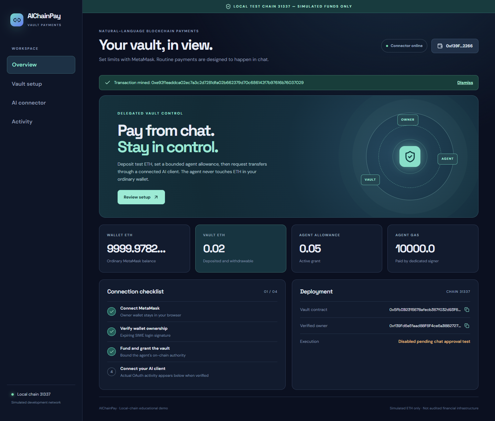

# AIChainPay

Natural-language blockchain payments through an AI connector. AIChainPay is an educational Solidity vault for **Sepolia test ETH only**. The owner uses MetaMask for setup, deposits, bounded agent grants, revocation, and withdrawals. A separate signer can later pay a recipient directly from deposited vault ETH, within on-chain limits, after a supported chat-client write confirmation. Routine payment approval is designed to stay in ChatGPT; it does not use a website approval link.

**Current evidence:** contract, dashboard, OAuth/MCP and signer pipeline pass local-chain tests. There is **no Sepolia deployment or verified ChatGPT connection yet**. The running connector defaults to `CONFIRMATION_ADAPTER=disabled`, so its MCP tool will not sign or broadcast a payment. The local signer test uses an explicitly controlled approval stub, not a human/chat approval. See [implementation status](./IMPLEMENTATION_STATUS.md).



The screenshot is from a headless browser using an injected local test wallet provider on chain 31337. It is not a Sepolia or real MetaMask screenshot.

## What is here

- [AIChainPay.sol](./contracts/AIChainPay.sol): deposited balances, owner withdrawal/direct payment, bounded per-agent grant with expiry, per-payment cap, optional recipient allowlist, epoch-based revocation, replay protection, payment records/events and reentrancy protection. Recipients receive ETH, not internal credit.
- [Frontend](./frontend/src/App.tsx): wallet connection, expiring SIWE login, deposit, grant/replace, revoke, withdraw, optional direct owner payment, chain balances, connector status and indexed vault activity.
- [Connector](./connector/src/index.ts): verified-wallet sessions, OAuth authorization code + PKCE, wallet-bound MCP tools, immutable payment preparation, durable agent transaction/reconciliation pipeline, and on-chain event indexing. Database is persistent SQLite for **one backend instance**.
- [Shared ABI/types](./packages/shared/src/index.ts) and [deployment script](./scripts/deploy.ts). The deploy script exports the actual ABI and network-specific manifest. The local test deployment is recorded in [deployment.31337.json](./packages/shared/src/deployment.31337.json); it disappears when the local chain restarts.

The owner key never enters the backend. The dedicated agent pays its own gas and can spend only the vault's credited ETH under the owner's active grant. Its key is still sensitive: compromise could spend the remaining authorized allowance. OAuth access, browser logout and on-chain revocation are separate controls. Public memos and addresses are visible on-chain. This is not audited or production financial infrastructure; see [security notes](./docs/security.md).

## Prerequisites and versions

Windows PowerShell and VS Code work with these commands. Use `npm.cmd` if PowerShell blocks `npm.ps1`. Install Node.js **22.13 or later** (tested 22.22.2), npm (tested 10.9.7), and MetaMask for manual wallet checks. Dependencies are pinned in [package-lock.json](./package-lock.json): Hardhat 3.20.0, Solidity 0.8.28, ethers 6.17.0, OpenZeppelin 5.6.1, MCP SDK 1.32.1, oidc-provider 9.12.2, React 19.3.1 and Vite 8.3.4. The exact versions and official compatibility references are in [architecture decisions](./docs/architecture-decisions.md).

```powershell
cd D:\AIChainPay
npm.cmd ci
npm.cmd run build
npm.cmd test
```

`npm.cmd run check:frontend` checks frontend types separately. The build includes contract compilation, connector type checking and a production frontend bundle. It does not prove any live chat or Sepolia behavior.

## Reproduce the local-chain demo

The local chain uses simulated ETH only. The development chain exposes **public deterministic test keys**; never use them on Sepolia or hold real funds with them. Open three PowerShell terminals in `D:\AIChainPay`:

```powershell
# Terminal 1 — leave running
npm.cmd run chain
```

```powershell
# Terminal 2 — deploy to that running chain
npm.cmd run deploy:local
```

Copy [connector/.env.example](./connector/.env.example) to `connector/.env` and change these local-only fields to match the deployment manifest: `SEPOLIA_RPC_URL=http://127.0.0.1:8545`, `CHAIN_ID=31337`, `ALLOW_LOCAL_CHAIN=1`, `CONTRACT_ADDRESS=<local address>`, `CONTRACT_CODE_HASH=<local codeHash>`, `CONTRACT_DEPLOYMENT_BLOCK=<local block>`, `AGENT_ADDRESS=<a local test account address>`, `PUBLIC_BASE_URL=http://localhost:3000`, `OAUTH_ISSUER=http://localhost:3000`, and `CONFIRMATION_ADAPTER=disabled`. Set `SESSION_SECRET` to at least 32 random characters. On Windows, this command puts a random value on your local clipboard without printing it; paste it into your local ignored `.env` file, never into chat:

```powershell
$bytes = New-Object byte[] 32
$rng = [Security.Cryptography.RandomNumberGenerator]::Create()
$rng.GetBytes($bytes)
[Convert]::ToBase64String($bytes) | Set-Clipboard
$rng.Dispose()
[Array]::Clear($bytes, 0, $bytes.Length)
```

For the local demo only, a Hardhat test account address may be used as `AGENT_ADDRESS` while execution stays disabled. Do **not** put a Hardhat key into Sepolia configuration. The local browser smoke script injects a test provider; a manual MetaMask run requires you to add local RPC `http://127.0.0.1:8545`, chain ID `31337`, and a disposable local test account in MetaMask. Confirm the URL and chain before signing; the login signature only authenticates your address, whereas deposit/grant transactions move simulated ETH or authorize a capped agent to spend your local vault credit.

```powershell
# Terminal 3 — connector serves API, MCP and the built frontend at one origin
npm.cmd run dev:connector
```

Open `http://localhost:3000`. To edit the UI with hot reload, use a fourth terminal with `npm.cmd run dev:frontend` and open Vite's displayed local URL; its API proxy points at port 3000. The backend reads `connector/.env`; deployment tooling reads root `.env`. These are ignored by Git. Do not reuse the local-chain setup for a real wallet or public endpoint.

With the chain, local deployment and connector running, optional integration checks are:

```powershell
npm.cmd run test:local-mcp
npm.cmd run test:local-ui
npm.cmd run test:local-execution
```

The MCP check runs a local SIWE/OAuth/PKCE client and verifies the execution-disabled path. The UI check launches headless Microsoft Edge using a local test provider, performs real local-chain deposit/grant actions, and updates the screenshot. The execution check uses a fresh disposable agent signer and a controlled approval stub to test exact recipient transfer, declines, nonce uniqueness, retry and crash recovery. **None is evidence of ChatGPT approval or Sepolia deployment.** The local tests assume the standard first Hardhat deployment address; restart/deploy as above if the chain was reset.

When you restart a fresh local chain, use a new ignored `DATABASE_PATH` (or deliberately reset only the old local-test database) so old local-chain event cursors are not mistaken for the new chain. Do not reset a Sepolia database this way.

## Sepolia deployment and manual acceptance

See [client integration](./docs/client-integration.md) and [demo script](./docs/demo-script.md) for the exact human steps and evidence to record. Obtain a Sepolia RPC URL, small amounts of Sepolia test ETH for the owner/deployer and the **separate** agent gas account, a public HTTPS URL with persistent SQLite storage, and account access to add a custom remote MCP server. No OpenAI API key is needed for the MCP server. Keep `DEPLOYER_PRIVATE_KEY` and `AGENT_PRIVATE_KEY` in separate ignored local/hosting secrets; never use the MetaMask owner key as either or paste any private key/seed phrase into chat.

1. Copy [.env.example](./.env.example) to root `.env`; fill `SEPOLIA_RPC_URL` and a **dedicated deployment-only** key locally. The deploy script uses that key and sends a deployment transaction that costs Sepolia test ETH. Run `npm.cmd run deploy:sepolia`. It prints the actual address, transaction hash, code hash and deployment block, then exports `packages/shared/src/deployment.11155111.json` and the ABI. There is no Sepolia address in this repository yet.
2. Copy [connector/.env.example](./connector/.env.example) to `connector/.env`. Set chain `11155111`, the actual RPC, manifest address/code hash/deployment block, a **different dedicated** `AGENT_PRIVATE_KEY`, HTTPS `PUBLIC_BASE_URL`/`OAUTH_ISSUER`, persistent `DATABASE_PATH`, random `SESSION_SECRET`, and leave confirmation **disabled**. Never put the deployer key in the connector or agent key in frontend Vite variables. To generate a new agent key on your own machine without displaying it in the terminal, run `node -e "console.log(require('ethers').Wallet.createRandom().privateKey)" | Set-Clipboard` in PowerShell, paste it into your ignored `connector/.env`, then clear the clipboard with `Set-Clipboard -Value ''`. Treat clipboard history as sensitive and keep a secure local backup of the agent key. Start the connector, note its displayed agent address, verify it matches your intended key, and fund that address with a little Sepolia test ETH for gas. Never paste the key into chat.
3. Copy [frontend/.env.example](./frontend/.env.example) to `frontend/.env` and set the public Sepolia chain and actual address. Run `npm.cmd run build`, then `npm.cmd run dev:connector` for a live connector or `npm.cmd run start -w connector` for a non-watch process behind HTTPS. Keep the host and persistent storage running; a laptop tunnel stops when the laptop/tunnel stops. Hosting cost/availability must be checked independently.
4. In MetaMask, verify you are on Sepolia, connect the owner address and sign the expiring login message. This signature **only logs in**. Then deposit a small amount and grant the displayed dedicated agent a small total allowance, a smaller per-payment cap, a short expiry and preferably a recipient allowlist. The deposit transaction credits the vault; the grant transaction authorizes that agent to spend up to those limits, including from later deposits until expiry/revocation. Each requires a separate MetaMask signature and test ETH for owner gas.
5. Add the HTTPS `/mcp` endpoint to ChatGPT if your account/workspace supports custom MCP servers. Complete wallet-linked OAuth in the browser. Verify read tools against actual Sepolia RPC data and run `probe_write_confirmation` to observe the client's harmless write approval. Inspect whether the native confirmation clearly shows the stored payment details for `execute_payment`. **Do not enable** `chatgpt_native` or set `CHATGPT_APPROVAL_TESTED=1` until this has been verified with the actual account/client; those settings are an operator assertion, not server-verifiable evidence of a click. If the client cannot provide an adequate in-chat approval, leave execution disabled and document the blocker. Do not substitute website approval or autonomous execution.
6. Only after that gate, test a tiny prepared transfer in chat, approve it there, check the receipt and exact recipient balance, test decline/no broadcast and over-limit refusal, and revoke with MetaMask. The routine payment itself should not return to the website or request a MetaMask signature. A submitted transaction may require a later `get_request_status` call; no unsolicited chat notification is implemented.

The [client integration guide](./docs/client-integration.md) includes prompts and the current ChatGPT/Claude evidence boundary. **No real Sepolia address, explorer verification, chat approval, MetaMask browser run, or GitHub remote URL is claimed yet.** A local Git repository was initialized; publishing a GitHub remote requires user-authorized account access.

## Important contract and state details

`deposit()` and `withdraw(amount)` adjust owner credit. `grantAgent(agent,totalAllowance,maxPerPayment,expiresAt,allowedRecipients)` replaces a grant and increments its epoch; an empty list means unrestricted recipients within the limits. `revokeAgent(agent)` invalidates the current epoch. `pay(...)` is an optional direct MetaMask owner payment. `executeAgentPayment(...)` is callable by the dedicated agent only and checks owner credit, active grant, epoch, expiry, deadline, caps, allowlist, replay ID and recipient. It sends actual ETH to the recipient. `getBalance`, `getAgentPermission`, `getPaymentCount` and `getPayment` are reads. The actual ABI is in [AIChainPay.abi.json](./packages/shared/src/AIChainPay.abi.json).

An MCP payment moves through `prepared → confirming → signing → signed → submitted → confirmed` where possible; decline/cancel/expiry/revert/reconciliation states are distinct. Confirmation depth is configurable and is not finality. Signed bytes are encrypted in local SQLite and persisted before broadcast; use one backend writer and do not use the agent account outside this app while it is operating. Event history is scoped to this vault and may report that indexing is catching up. The browser dashboard is for setup/inspection, not per-payment approval.
